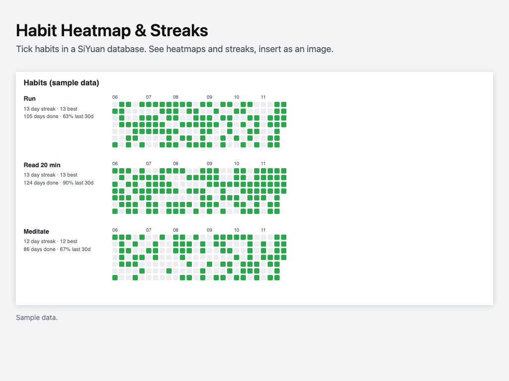

# Habit Heatmap & Streaks (SiYuan plugin)

[中文](README_zh_CN.md)

Turn the habits you tick off in a SiYuan database into GitHub-style heatmaps with streak stats, and insert the result into your document as an image. No separate data store: your check-ins stay in your own database.

## How it works

1. Create a database (attribute view) with one row per day. Add a **Date** column (or use Created time) and one **Checkbox** column per habit.
2. Tick the box for each habit you did that day.
3. Click the calendar icon in the top bar (or the database block menu > "Habit Heatmap & Streaks"). Pick the database and date column.

For every habit you get a heatmap (3 months, 6 months or 1 year) plus: current streak, best streak, total days done and completion rate over the last 30 days. Optional "perfect days" row shows days when all selected habits were done.

- A streak stays alive until you miss a full day: if today is not ticked yet, it counts back from yesterday.
- If several rows share a date, a habit counts as done if any of them is ticked.
- Insert as an SVG image into the current document, or download the SVG. Images are static; re-insert to refresh.
- Week start (Monday or Sunday) and heatmap color are configurable.

## Free and Pro

The core is free forever. Pro is an optional one-time license ($12) for people who want reports and exports.

| | Free | Pro |
|---|:---:|:---:|
| Heatmaps for every habit (3 months / 6 months / 1 year) | ✓ | ✓ |
| Current streak, best streak, days done, 30-day rate | ✓ | ✓ |
| "Perfect days" row, week start, 4 preset colors | ✓ | ✓ |
| Insert as image, download SVG | ✓ | ✓ |
| Year in review: printable report (save as PDF) with a full calendar-year heatmap per habit, completion %, longest streak, best month and best weekday | | ✓ |
| Compare habits: monthly completion % per habit as one chart (insert or download) | | ✓ |
| CSV export: one line per day, 1/0 per habit (opens in Excel / Numbers / Sheets) | | ✓ |
| Any heatmap color + Dark, Sepia and High-contrast themes | | ✓ |

To unlock Pro, click "Get a license key" at the bottom of the plugin window, pay once, and paste the key into the License key box. The key is checked on your device (Ed25519 signature); nothing is sent anywhere and there is no account. No telemetry in either version.

## Notes

- Version 0.2.0. The streak, grid, database-parsing, report, CSV and license logic is covered by automated tests (`npm test`). The plugin UI has been type-checked and built but not yet exercised in a live SiYuan app by the author; if something does not read correctly, please open an issue with the column types involved.
- Dates are read as local calendar days.
- Rows are read from the database's current view as returned by SiYuan's API (grouped table views are flattened).

## More from this developer

[Database Charts & Reports](https://github.com/JUDESTRAHM/siyuan-db-reports): bar, line, pie and donut charts from any database (free), with Pro Excel and printable PDF reports.

## Build

`npm install && npm run build && npm test`. MIT licensed.
