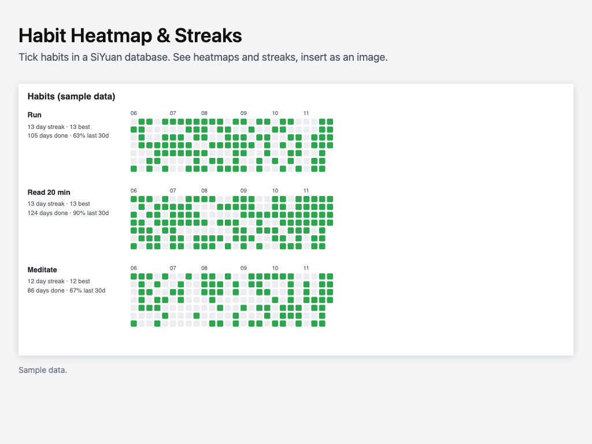

# 习惯热力图与连续打卡（思源笔记插件）

[English](README.md)

把你在思源数据库中打卡的习惯，生成 GitHub 风格的热力图和连续天数统计，并以图片形式插入文档。没有独立的数据存储：打卡记录就在你自己的数据库里。

## 使用方法

1. 创建一个数据库（属性视图），每天一行。添加一个**日期**列（或使用创建时间），并为每个习惯添加一个**复选框**列。
2. 每天为完成的习惯勾选对应复选框。
3. 点击顶栏的日历图标（或数据库块菜单 > “习惯热力图与连续打卡”），选择数据库和日期列。

每个习惯都会生成热力图（3 个月、6 个月或 1 年），并显示：当前连续天数、最长连续天数、累计完成天数、近 30 天完成率。还可以添加“完美日”行，显示所选习惯全部完成的日子。

- 只要没有漏掉完整的一天，连续记录就不会中断：如果今天还没勾选，则从昨天开始往回计算。
- 如果多行日期相同，只要其中任意一行勾选，该习惯当天即视为完成。
- 可将 SVG 图片插入当前文档，或下载 SVG。图片是静态的，需要刷新时请重新插入。
- 可设置每周起始日（周一或周日）和热力图颜色。

## 免费

以上功能全部免费，采用 MIT 许可证。无需账号，无遥测，不向任何地方发送数据。

## 说明

- 版本 0.1.0。连续天数、网格和数据库解析逻辑有自动化测试（`npm test`）。界面已通过类型检查并成功构建，但作者尚未在实际运行的思源应用中完整测试；如果发现读取不正确，请提交 issue 并附上涉及的列类型。
- 日期按本地日历日读取。

## 作者的其他插件

[数据库图表与报表](https://github.com/JUDESTRAHM/siyuan-db-reports)：任意数据库生成柱状图、折线图、饼图和环形图（免费），专业版支持 Excel 与可打印 PDF 报表。

## 构建

`npm install && npm run build && npm test`。MIT 许可证。
